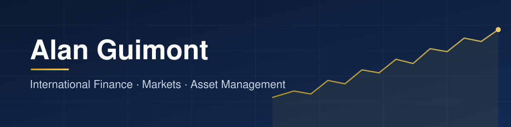

  

  

  
  

---

### 👋 About me

I'm training in international finance, with a focus on **financial markets** and **asset management**. I'm building my finance and data skills through my master's, professional certifications and hands-on projects.

- 🎓 **MSc International Finance**, [Rennes School of Business](https://www.rennes-sb.com/)
- 🤝 **RSB Company Ambassador**, interviewing industry speakers
- 💬 French & English, fluent

### 📌 Currently

- 📘 **AMF certification**: exam in December 2026
- 📈 **CFA Level I**: sitting in May 2027
- 🐍 Improving my **Python & pandas** for financial data
- 🔍 Looking for a **finance internship** (May–Aug 2027) and an **apprenticeship** in Paris (Sept 2027)

---

### 🛠️ Tools

  
  
  
  
  

---

### 🏅 Certifications & Badges

  

  
  

**In progress:** AMF Certification (Dec 2026) · CFA Level I (May 2027)

---

### 📂 Projects

Finance and data projects in Python coming soon.
